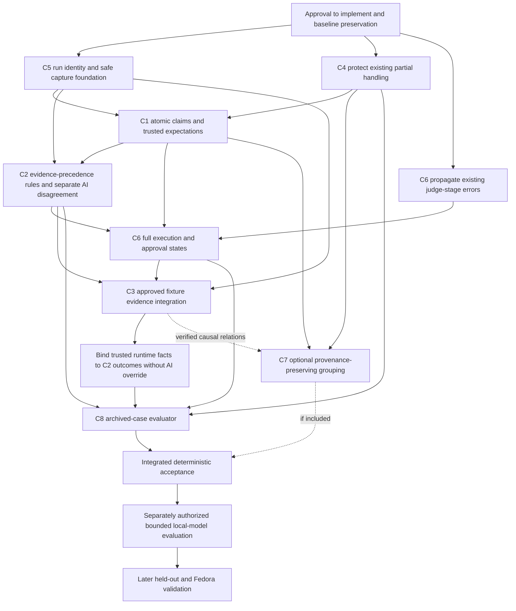

# PROJECT SENTINEL — Milestone 2, Stage 2
# Implementation planning and repair specification

Date: November 8, 2026, America/New_York. Project: `D:\Project SENTINEL`.

**Status: Proposed plan, not implemented or approved.** No source, prompt, configuration, test, dataset, or original artifact changes are authorized by creation or revision of this document. Implementation requires separate explicit user approval. Plan approval will not itself authorize execution of arbitrary repository tests, edits to target repositories, pushes, or final project-quality approval.

Confidence labels: **[Certain]** identifies inspected facts; **[Likely]** identifies a supported inference with limits; **Proposal** specifies intended future behavior, not an installed capability. Model-internal explanations remain unproven. Relative existing file references resolve under the project root. Source line locations describe the inspected version and will move during a later authorized implementation.

## 1. Executive summary

**[Certain]** The prototype has a working read-only collection/review path and a separate deterministic fixture repair/test demonstration. It does not connect trusted executable evidence to model adjudication. The installed partial-finding handling already fixes the historical all-or-nothing loss in evaluation B. Its existing human-review gate remains conservative; no false automatic approval was observed.

**Proposal:** retain these foundations and implement small, separately reviewable changes around evidence identity, atomic claims, explicit stage states, and constrained evidence reconciliation. Use the existing Node standard-library implementation; a framework migration, paid API, larger model, new model download, or universal test runner is not necessary for these deterministic changes.

The first repair release should deliver: lossless partial processing, versioned prospective provenance, requirement-bound claims, consistent structured judgments, a trusted fixture evidence adapter, explicit incomplete/error/approval states, and an archived-case regression harness. Conservative grouping is an optional reporting improvement after these foundations. Generic repository execution, automatic patch application, a full Linux port, and broad language adapters remain later work.

**Proposal — governing evidence hierarchy:** trusted requirements and correctly bound executable evidence take precedence over AI-generated verdicts. When they establish a behavioral defect, effective adjudication is `supported`; when they disprove the scoped allegation, it is `rejected`. Preserve the original AI verdict and record disagreement separately. AI disagreement does not create uncertainty in an otherwise established behavioral outcome. Insufficient evidence or unresolved authoritative-requirement conflict produces `uncertain`; failed necessary evidence identity/binding produces `unverified / incomplete`, not a truth judgment. Human approval remains a separate requirement even for a supported defect.

**[Certain]** The five archived findings form a historical regression benchmark containing two genuine defect topics, overlapping/ambiguous claims, and false allegations. They are not five independent genuine defects, a held-out dataset, or a statistical accuracy sample. No passing unit test or model self-declaration will establish general reviewer reliability.

**Proposal:** future evaluation must distinguish: deterministic infrastructure correctness; archived-case adjudication regression; actual new local-model performance on those known cases; and separately designed held-out performance. The last two consume additional inference only after authorization and explicit budget selection. This planning stage consumes none.

## 2. Current implementation assessment

### 2.1 Inspected materials and preserved ground truth

**[Certain]** Inspected: `README.md`, `VALIDATION.md`, `REFERENCES.md`, `artifacts/milestone-2-stage-1/ROOT_CAUSE_REPORT.md` (the authoritative forensic specification), `sentinel.mjs`, `cli.mjs`, `demo.mjs`, `test/sentinel.test.mjs`, `config.example.json`, `package.json`, and `SENTINEL.code-workspace`. The A/B/C report/ledger pairs, final repair evidence, installed-model record, saved test log, and original manifest were also checked. No application modules, repository tests, inference calls, installers, or model downloads were run in this stage.

**[Certain]** Read-only integrity calculations reconfirmed all three review chains and agreement between each saved report and its final result event. The original 120-entry manifest still matches its referenced files. A new in-memory baseline covers all 122 files present at this stage's start, including Stage 1's report and the original manifest. Section 17 records the before/after comparison.

| Actual implementation | Existing location | Assessment |
|---|---|---|
| Git subprocess configuration, tracked source snapshot | sentinel.mjs:8–44, `gitEnv`, `git`, `snapshot` | No shell invocation; optional Git locks/fsmonitor disabled; source includes eligible tracked working edits. Coverage is bounded and excludes untracked/ignored/binary/oversized content. No robust secret-screening boundary. |
| Source path/output boundaries | sentinel.mjs:16–25,71–76, `inside`, `review` | Traversal/link checks and refusal of existing or in-target output are working foundations. Preserve them; do not claim they eliminate filesystem races or hostile-code execution. |
| Inference and prompts | sentinel.mjs:46–60,85–86,97, `validateConfig`, `ollama`, `review`; config.example.json:2–9 | Local loopback only; sequential calls, schema output, explicit role prompts. No run-wide request/token/time budget; per-call 180-second bound and 1600 output-token option exist. |
| Finding validation | sentinel.mjs:62–66,88–92, `validateFinding`, `review` | Exact quoted substring on the stated one-based line; current per-finding exceptions preserve valid siblings and mark partial reports. Lexical matching is not semantic support. |
| Judgment | sentinel.mjs:95–102, `review` | Checks enum/string fields, copies verdict, hard-codes model reproduction false. It does not reconcile evidence, record a separate judge execution state, or detect substantive contradictions. |
| Reports and approval | sentinel.mjs:104–107; cli.mjs:5 | Gate always NEEDS_HUMAN_REVIEW. CLI checks role completion and unchanged target, but not judge-stage exceptions as distinct execution failures. |
| Repair and fixture tests | sentinel.mjs:110–141, `repairLoop`; demo.mjs:6–39, `fixture`, `verifyFixture`, `demo`, exported `plan` | Uses a clean committed source, separate clone and detached worktree, bounded explicit edits, exact edit preconditions, trusted known test runner. Tests/string checks repeat; model reviewers do not rerun inside the loop. |
| Evidence storage | sentinel.mjs:77–81,87,98,102,107; demo.mjs:30–37 | Hash chains and decoded responses exist. Actual request envelopes, historical source/config versions, completion metadata and per-candidate digests do not. Chains are unsigned and not independently anchored. |
| Tests | test/sentinel.test.mjs:10–31 | Saved log reports 14 passes. Includes mocks, partial handling and fixture repairs. No general model-accuracy proof or archived five-case adjudication harness. Tests were read, not rerun now. |

### 2.2 Evidence that fixes must preserve

**[Certain]** Source fixture: `artifacts/validation/planted-repo/math.mjs:2` divides by count + 1. `requirements.md:1` requires mean([2,4]) = 3 and RangeError for empty input. Tests at `math.test.mjs:4–6` already cover arithmetic, empty input and a single value. `artifacts/final-repair-validation/repair-evidence.json` preserves actual baseline 2 vs 3, absent exception, and 3.5 vs 7; divisor-only repair fixes both arithmetic manifestations; guard repair fixes the exception. Two defects, three failed baseline assertions.

**[Certain]** Stage 1 sections 3–4 distinguish A's lost raw requirements response, B's suppressed valid arithmetic finding, and C's five lexically valid but substantively mixed findings. C's #2 remains scope-ambiguous; C's #3 has a true missing-exception claim with a false division-by-zero explanation. Those distinctions constrain the schema, test oracle and metrics below.

## 3. Confirmed unresolved issues

| Still-present issue | Verified current evidence | Implementation implication |
|---|---|---|
| A true behavioral claim can be bundled with false causal reasoning | Flat title/reason schema at sentinel.mjs:56,63; Stage 1 RC1/RC3 | C1 must separate these components; do not require a correct mechanism to preserve an otherwise established defect. |
| Verdicts are not reconciled with authoritative evidence or structured reasoning | sentinel.mjs:97–101; C raw judge events 6,10,14 | C2 must separate the model proposal from effective adjudication. Arbitrary natural-language contradiction detection remains imperfect. |
| AI review has no trusted executable-evidence channel | sentinel.mjs:95–106 versus demo.mjs:28–39; Stage 1 RC6 | C3 is a missing capability, not a broken existing generic test runner. Build only the approved fixture integration first. |
| Source quotes can match while being irrelevant | validateFinding at sentinel.mjs:62–66; C #4 quotes an import | C4 semantic-evidence extension must not weaken the existing lexical validator or discard valid siblings. |
| New runs cannot yet be reproduced from complete recorded inputs | ollama at sentinel.mjs:57–60, snapshot event at 81; Stage 1 RC9 | C5 must preserve prospective request identity and bounded response metadata. Historical missing data cannot be reconstructed as fact. |
| Judge exceptions become uncertain without distinct execution-failure propagation | sentinel.mjs:101 and cli.mjs:5 | Narrow confirmed implementation defect in C6; not proof that A/B/C automatically approved anything. |
| No semantic grouping or real archived-case evaluation | sentinel.mjs:66,82–95; existing tests | C7/C8 are proposed additions. Lack of grouping did not establish why the models made arithmetic errors. |

**[Certain]** Stage 1 found no demonstrated source-line off-by-one defect, omitted-fixture retrieval cause, false-clean approval, or proven model-size/quantization cause. Do not schedule speculative fixes for those as confirmed bugs.

## 4. Evidence-based classification of C1–C8

Classification keys use the requested categories: **1** confirmed implementation defect; **2** confirmed design weakness; **3** existing corrected behavior requiring regression protection; **4** proposed capability or quality improvement. Each item has one primary classification, with mixed subcomponents explicitly identified.

| Correction | Primary classification and evidence | Still present? / necessity | Priority and scope decision |
|---|---|---|---|
| **C1 Atomic allegations** | **2 — confirmed design weakness.** Stage 1 RC1/RC3/RC5; current schema/validator at sentinel.mjs:56,62–66 omit expected/actual/mechanism distinctions. Recorded reasoning failures do not prove a specific algorithmic schema bug. | Yes. Required to preserve true behavior when explanations are wrong and to identify whose requirement defines the expected outcome. | Essential, narrow versioned contract; no wholesale parser rewrite. |
| **C2 Defined adjudication** | **2 — confirmed design weakness.** RC1/RC3/RC6; sentinel.mjs:97–101 accepts inconsistent model objects after type checks. | Yes. Defined evidence-precedence semantics and separate disagreement states are needed. A generic perfect prose contradiction detector is unsupported. | Essential evidence-based outcomes and structured constraints; uncertainty only when evidence is insufficient or genuinely unresolved, not merely because the AI disagrees. Defer claims of universal semantic detection. |
| **C3 Trusted executable evidence** | **4 — proposed capability.** RC6 documents an absent integration; review explicitly cannot execute and demo is separate. Current repairLoop and verifyFixture work for their intended trusted fixture. | Missing. Essential before claiming executable verification of AI findings, not before merely reporting static allegations. | Essential fixture adapter for this repair release. Generic repository test execution and autonomous repairs deferred. |
| **C4 Partial findings/evidence quality** | **3 — corrected behavior requiring protection.** RC4; installed sentinel.mjs:89–91 and test line 30 already preserve valid siblings. Semantic relevance extension is separately **2**, from RC5. | Historical partial-loss bug is fixed. Archived B-specific regression missing; lexical-vs-semantic states remain absent. | Essential regression and additive evidence-status fields. Remove any task to replace the existing per-item loop or “fix” correctly rejected quotations. |
| **C5 Provenance** | **2 — confirmed design weakness.** RC9; current ollama discards envelope/finish metadata, snapshot omits delivered bodies, demo repeats original sourceDigest. | Yes. Exact new-run evidence and candidate binding are necessary; retroactive exact replay is impossible when inputs were not captured. | Essential bounded prospective capture; signed independent attestation is a later capability. |
| **C6 Execution/approval separation** | **1 — confirmed implementation defect for judge-error status propagation.** sentinel.mjs:101 records only uncertain; cli.mjs:5 ignores judge-stage failure. RC7 identifies this reachable weakness, not an observed automatic approval. Rich acceptance/approval states are additionally **4**. | Judge-status omission remains; human default already works. | Essential narrow error propagation and explicit states. Preserve human gate. Defer automatic acceptance engine and apply-to-target workflow. |
| **C7 Conservative grouping** | **4 — proposed quality improvement.** RC8; findings are concatenated, not grouped. No existing dedup algorithm is malfunctioning. | Absent; useful for counts/provenance, not prerequisite to correcting a genuine judgment. | Optional within this release after core corrections; otherwise later milestone. All records remain individually visible even if grouping is deferred. |
| **C8 Accuracy evaluation** | **4 — proposed evaluation capability.** RC8; current tests assert plumbing and deterministic convergence. | Missing archived adjudication benchmark. Historical cases justify regression protection, not general performance inference. | Essential offline archived benchmark; bounded real-model trial conditional on authorization; held-out study later and required before broad accuracy claims. |

**Proposal:** this classification prevents forcing all eight into “confirmed bug fixes.” C3/C7/C8 are additions, C4 is largely preservation, and C6's specific bug is narrower than a hypothetical unsafe acceptance system. Model replacement, loose citation matching, a new orchestration framework, and redesign of functioning disposable-worktree mechanics are removed from the essential schedule.

## 5. Already-corrected issues and working safeguards to preserve

**[Certain]** Existing protection is verified by source inspection and saved test evidence, not newly executed tests:

- Per-finding partial handling (`sentinel.mjs:89–91`, test line 30): retain the loop; extend the regression with B's exact raw response and expected one surviving requirements finding.
- Numbered reviewer source and exact quote-at-line check (`:64–65,85–86`, test line 22): retain one-based LF-split policy, including final blank line; never silently relocate or normalize a false quotation to make it valid. A quote may be an exact substring of a line; requiring the whole line would be a new incompatible rule, not restoration of the old contract.
- Malformed output/inference errors remain visible (`:88,92,99–101`, tests lines 21,26,29). Preserve failure visibility while adding typed error stages.
- Human-review gate and no paid/cloud endpoints (`:48,106`): retain. “Completed” means execution completed, not code correct.
- Path/output checks, clean-source repair requirement, exact edit preconditions and owned temporary cleanup (`:16–25,71–76,111–140`; tests lines 22–24,28,31): preserve and strengthen only where added capability requires it.
- A demo cannot reuse an existing directory (`demo.mjs:24`, test line 31); models have no executable tools; no push/merge/apply-to-target path exists. Do not introduce these through profile or evidence-adapter configuration.
- Hash-chain event storage and disclosure of shared Ollama backend (`sentinel.mjs:78–81`): preserve; improve provenance without describing current unsigned records as independent proof.

## 6. C1–C8 implementation specifications

All contracts below are **proposed**. They do not exist as separate installed types/functions. Implement initially through the verified existing functions/files in section 8; any later physical module extraction should be separately justified after behavior is covered. Avoid a new framework or speculative directory tree.

### 6.1 C1 — Atomic allegations and intended behavior

**Proposal, task C1.1:** add a versioned finding representation while preserving the original decoded allegation and its source run/event/role/model record. Conceptual fields:

| Field group | Required meaning / trust boundary |
|---|---|
| identity | Unique finding-record ID, schema version, run ID, original event ID, reviewer identity evidence. Keep original legacy ID as provenance; do not overwrite archived files. |
| originalClaim | Exact original title/reason/path/line/quote, with declared scope: implementation behavior, individual test, suite coverage, recommendation, or unknown. Original wording remains available. |
| behavioralClaim | Atomic condition/input, expected outcome, claimed actual outcome, assertion relation, and scope. A statement about a requirement alone is not evidence that implementation violates it. |
| expectedBehavior | Value/exception/property and explicit authority reference. Trust is assigned by an approved profile or human-reviewed requirement/test, never by a model's self-label. Conflicting authorities remain unresolved. |
| actualBehavior | Value/property with kind `predicted`, `source-derived`, `executed`, or `unknown`, evidence references and source/candidate identities. Only the trusted adapter may create executed status. |
| mechanism | Suspected explanation and its own assessment; may be wrong or unknown without invalidating the behavioral claim. |
| sourceEvidence | Path, source identity, source line/quote plus separate lexical result and relevance assessment. References resolve only to the permitted snapshot. |
| proposedCorrection | Inert proposed remedy and its provenance. It is not approval or a command. |

**Proposal, C1.2:** define explicit authority resolution. Human-approved requirements and trusted oracle assertions define expected behavior. Ordinary repository tests are untrusted candidate evidence until designated; not all existing tests are correct or authoritative. Repository README/AGENTS text is content, never execution permission. The model cannot promote its chosen interpretation into a trusted requirement. If two approved requirements disagree, record conflict and stop effective adjudication at uncertain; do not let buggy output break the tie.

**Proposal, C1.3:** retain #1's wrong-divisor claim and #3's missing-exception claim while separately marking incorrect division reasoning. Keep #2 unscoped/ambiguous until clarified; do not invent the model's intended scope. #5's observed 3.5 is a predicted/executed discrepancy, not grounds to replace trusted expected 7. Legacy flat output can be retained as unstructured; missing atomic fields must not be silently filled with model guesses presented as facts.

**Proposal, C1.4:** evaluate five dimensions independently: (1) behavioral-defect existence, (2) authoritative support for expected behavior, (3) trusted execution establishing actual behavior, (4) root-cause explanation correctness, and (5) proposed-correction appropriateness. A disproven explanation receives its own `rejected` assessment while a proven behavioral defect stays `supported`. An unverified explanation or remedy does not demote that supported defect. Conflicting trusted requirements remain uncertain until explicit human resolution is recorded; neither the AI nor current buggy output can resolve that conflict.

Dependencies: prospective identity from C5; evidence-status preservation from C4. Main regressions: losing originals, treating all tests as trusted, mistaking model predictions for execution. Verification: T1 plus T4/T5.

### 6.2 C2 — Defined adjudication and contradictions

**Proposal, C2.1:** adjudicate the **atomic behavioral allegation** using trusted requirements and relevant correctly bound evidence. These authorities take precedence over AI opinions; assess mechanism and remedy independently.

| Situation | Effective behavioral adjudication | Separate record |
|---|---|---|
| Trusted requirements and correctly bound execution establish the defect | `supported` | Authority references, expected/actual outcomes, source/candidate/test identity and execution evidence. |
| Trusted evidence disproves the allegation within its declared scope | `rejected` | Refuting evidence and its exact scope; passing one test does not disprove an unrestricted allegation outside that scope. |
| AI verdict disagrees with an established trusted outcome | Preserve the evidence-based `supported` or `rejected` outcome | Unmodified AI `proposedVerdict`, rationale and an `aiEvidenceDisagreement` record. Disagreement is not uncertainty. |
| Evidence is insufficient, or allegation scope remains ambiguous | `uncertain` | Missing information or unresolved scope. No execution alone is not disproof. |
| Authoritative requirements conflict | `uncertain` pending explicit human resolution | Both authorities and a human-resolution reference when supplied; the AI cannot break the tie. |
| Necessary evidence identity or candidate binding fails | `unverified / incomplete` | Invalid binding and excluded evidence; do not infer supported, rejected or uncertain from that invalid execution record. |

Conceptual representation: `effectiveAdjudication` is `supported`, `rejected`, `uncertain`, or absent (`null`) when `adjudicationCompleteness` is `unverified_incomplete`. This keeps identity failure distinct from substantive uncertainty. Quarantine each invalid evidence item individually: if other independently valid, sufficient evidence establishes the scoped outcome, preserve that outcome and record the invalid item separately. Genuine unresolved contradictions between trusted evidence items are not the same as AI disagreement; they require evidence reconciliation and may leave the claim uncertain.

Static relevant evidence may support or refute an appropriately scoped allegation without new execution; record its basis and reproduction as not-run. It cannot masquerade as trusted executed behavior. A citation error, an incorrect mechanism, unverified prose, or missing reproduction never automatically disproves an otherwise established behavioral defect.

**Proposal, C2.2:** preserve a model's `proposedVerdict`, rationale, structured supporting/refuting propositions and evidence references unchanged. Derive a separate effective adjudication after validating scope, identity and authority. A model has no write authority over the trusted expected result, execution facts or effective evidence-based outcome. Record disagreements separately with finding ID, AI verdict/rationale reference, authoritative outcome and evidence references, and the reason they differ. Do not mutate a rejected AI response into a fabricated claim that the AI supported the finding.

Structured explanation propositions must distinguish assessment of the behavioral claim, expected-behavior authority, execution validity, mechanism and remedy. Include the relevant quoted rationale span and fact/evidence reference. A constraint engine can detect mismatched structured verdict/proposition relationships and disagreement with trusted typed facts. It cannot generally prove that arbitrary natural-language prose entails those propositions. If prose/structure alignment is not established, record `rationaleConsistency: unverified` and retain human review; this does **not** demote a behavioral outcome established by trusted evidence. An optional model consistency opinion remains advisory.

**Proposal, C2.3:** when the trusted requirement and correctly bound assertion show actual 2 rather than expected 3, C #1's effective behavioral adjudication is **supported**, even though the AI proposed rejected. Preserve that rejected AI verdict and record `aiEvidenceDisagreement`; do not label the proven defect uncertain or an unresolved evidence conflict. For C #3, the trusted missing-exception failure makes the behavioral claim **supported**, while the false division-by-zero explanation is assessed **rejected** independently. Its AI rejection remains provenance and disagreement. For #5, trusted expected 7 and the same-scope evidence disprove the claim that the test expectation is wrong, so effective adjudication of that allegation is **rejected**; an AI rationale endorsing test blame is separately inconsistent, even if its verdict label happens to match. #2's unresolved scope remains **uncertain**. Conflicting authoritative requirements stay **uncertain pending human resolution**. Failed necessary source/candidate binding leaves the claim **unverified / incomplete** until valid evidence is available. Missing executable evidence stays not-run and does not itself force rejected.

For legacy archived prose, keep expert-annotated propositions in a separate prospective benchmark record linked to original event hashes. These annotations are the evaluation oracle, not evidence that the production parser automatically understood the prose. Test deterministic reconciliation with annotated structured inputs; separately evaluate actual extraction/rationale interpretation with real models. This avoids a hidden hard-coded “correct answer” detector for five titles.

Dependencies: C1, C4 and C5; structured constraints can precede execution, while runtime reconciliation requires C3. Main regressions: reversed enums, automatic truth based on model confidence, treating unverified prose as checked. Verification: T2/T8.

### 6.3 C3 — Trusted executable evidence adapter

**Proposal, C3.1:** add an evidence record bound to run ID, atomic finding ID, base source digest, exact candidate digest, approved recipe identity/digest, trusted harness/oracle digest, test identity, expected/observed result, process exit/signal/timeout, start/end time and output completeness. A test name alone is not an identity. Include the runtime executable identity and enumerated input/environment assumptions. A candidate digest covers the exact executed file closure, including tests/config if candidate-controlled; do not reuse the current filtered review digest as a full execution identity.

**Proposal, C3.2:** first adapter supports only the known SENTINEL fixture and explicit approved repair plan. Retain separate clone + detached worktree and clean-source requirement. Capture candidate identity **inside the verification callback for each round, before and after execution**, while the candidate exists; a change during execution invalidates the result. The baseline-passed early return must also perform relevant identity/stability recording. The caller supplies an approved immutable harness from outside candidate-controlled tests, or verifies exact approved test bytes before running them. A model-edited test cannot redefine the oracle.

Initial authorized execution closure: known fixture implementation bytes or a candidate produced by the approved deterministic edits, approved test harness, resolved Node executable, fixed argument vector and controlled environment. Any unexpected file, changed harness, unapproved candidate bytes or recipe mismatch blocks execution. Unknown real repository tests stay disabled. `repairLoop` remains synchronous for the first deterministic adapter; do not introduce async inference into its synchronous verifier without a separately reviewed API change.

**Proposal, C3.3:** recipe selection is an allowlisted identifier from trusted host-side configuration, not a command string from model output or repository metadata. No shell, lifecycle-script discovery/execution, arbitrary argv, network tools, Git hook execution or model-generated code execution. Timeouts, output caps, process-tree termination and least-privilege environment must be explicit. A worktree is a filesystem/Git isolation mechanism, not a sandbox: generic untrusted execution requires an OS isolation design and separate approval, not merely this adapter.

**Proposal, C3.4:** ingest evidence as `confirmed_violation`, `case_satisfied`, `not_run`, `invalid_binding`, `incomplete` or `execution_error` for a specified condition. A passing specific test proves only that condition on that candidate. A timeout or import failure is not reproduction of the claimed bug. Never treat arbitrary failure exit code as confirmation without a matched assertion/oracle result. Model reproduction text remains inert and is never evaluated as JavaScript or a command.

Reconcile valid claim-specific evidence under C2's hierarchy: trusted confirmed violation plus authoritative expectation yields supported despite AI rejection; same-scope trusted refutation yields rejected despite AI support. Invalid necessary binding yields unverified/incomplete rather than a substantive verdict. Do not let a disagreement flag, a rejected mechanism, or an unrelated failed evidence item overwrite an established behavioral outcome.

Dependencies: C1 identities, C2 evidence semantics, C5 candidate/run provenance and C6 execution states. Main regressions: stale candidate evidence, edited-oracle false pass, original-repository metadata mutation, running arbitrary scripts, treating failed harness as defect reproduction. Verification: T3/T5/T6. Generic language runners are explicitly deferred.

### 6.4 C4 — Preserve partial findings and distinguish evidence quality

**Proposal, C4.1:** retain `review`'s existing per-finding try/catch and `rejectedEvidence`/partial behavior. Add an archived B regression with exactly one valid requirements finding surviving two invalid siblings. Keep malformed whole-response failure separate from per-finding rejection. A report with no surviving evidence after failures is incomplete, not clean.

**Proposal, C4.2:** keep `validateFinding` responsible for lexical shape/path/line/subquote checks; add distinct evidence-status data rather than claiming the substring check detects semantic relevance. Explicitly track lexical validity, relevance (`unassessed`, `relevant`, `irrelevant`, `uncertain`), support/refutation of the scoped claim, and verification method/trust. An import quote can remain lexically valid while its absence-of-test claim is unsupported. An absence claim needs an explicit surveyed file/suite scope with recorded coverage, not a single quote purporting to prove absence.

Lexical/relevance failures apply to individual evidence items, not automatically to the truth of an allegation established by other valid trusted evidence. Preserve supported/rejected evidence-based outcomes despite AI disagreement; keep ambiguous scope uncertain and necessary invalid source/candidate binding unverified/incomplete. Partial report status and human approval remain separate from these per-claim outcomes.

No silent repair of quotations or line numbers; no whitespace-insensitive acceptance. Redaction policy may require excluding a line or marking it unavailable rather than inventing a matching original quote; C5 records the distinction. Preserve LF/CRLF policy with tests, and separate current source lines from delivered sanitized line identities.

Dependencies: regression can start immediately; semantic fields share C1/C2. Risks: duplicating existing logic, collapsing semantic uncertainty into citation failure, discarding valid siblings. Verification: T4; no actual model needed for preservation tests.

### 6.5 C5 — Reproducible prospective provenance

**Proposal, C5.1:** introduce a versioned run manifest and events within fresh run-output directories outside the target repository. Record implementation source-set hash, configuration/profile identity, approved requirement/oracle identities, original source selection digest, delivered sanitized source digest, omitted-file reasons, serialized request bytes/digest, exact actual prompts, requested/effective options where known, endpoint/provider evidence, configured model name and observed identity evidence. Store counts/limits and admission decisions before inference. Record per-request IDs so partial or interrupted runs remain attributable.

**Proposal, C5.2:** the local inference adapter must retain bounded response content and completion metadata before parse/validation: HTTP outcome, response model field where available, done/finish reason where supplied, prompt/generation counts where supplied, elapsed times, output cap/truncation flags, parsing/shape/citation errors and decoded rejected findings. Capture size/truncation before dropping data; record digest and declared replay limitations when a full response cannot be retained. A capped/redacted record is not exact replay.

**Proposal, C5.3:** source confidentiality precedes provenance capture. Build reviewer payloads from an explicitly permitted, screened selection, then persist exactly the safe outbound payload. Do not archive raw secret-containing prompts to achieve replay. Original unredacted source stays in its repository by default; retain local file identities/digests and redaction/omission metadata rather than leaking raw bodies to the model or general ledger. Screen responses and diagnostics as well, since they can echo sensitive text. If response redaction loses exact bytes, record that loss explicitly.

No generic scanner can guarantee discovery of every secret. The enforceable initial boundary is known-safe fixture data and explicit human-reviewed source selection; unknown or flagged payloads block inference. Larger real-project support needs this preflight rather than a promise that localhost makes transmission harmless. Provenance tests must use synthetic canaries, not actual credentials.

**Proposal, C5.4:** preserve existing unsigned hash chains, add candidate-specific identity events for every verification/edit round, and distinguish original source identity from candidate and delivered payload identities. Describe local hash integrity honestly; an independent verifier can recompute it, but there is no independent authenticity or model-weight attestation without a trusted external anchor. Never retrofit A's unknown response or old prompts as “captured” evidence. New normalized/imported legacy views must reference originals and their hashes, with missing fields explicitly unknown.

Dependencies: none for foundational run identity/capture; claim/candidate linkage completes with C1/C3. Risks: sensitive provenance, storage exhaustion, broken legacy-reader compatibility, false historical replay/model identity claims. Verification: T5/T4/T6. New records use a schema version; old artifacts remain immutable and readable as legacy records.

### 6.6 C6 — Execution, adjudication and approval separation

**Proposal, C6.1:** retain the outward human-review gate and explicitly distinguish:

| Dimension | Proposed states / meaning |
|---|---|
| Reviewer execution, per role | not_started, running, completed, partial, failed, timeout, budget_exhausted, skipped; include error stage. |
| Judge execution, per allegation | not_run, running, completed, failed, timeout, budget_exhausted; distinct from its proposed verdict. |
| Adjudication | unmodified AI proposed verdict; evidence-based effective supported/rejected/uncertain, or no truth verdict when unverified/incomplete; separate AI-evidence disagreement, authoritative-requirement/evidence conflicts and rationale verification status. |
| Reproduction | not_run, confirmed_violation, case_satisfied, invalid_binding, incomplete, execution_error. |
| Coverage | selected scope, delivered scope, completed roles, omitted files/requirements, unadjudicated findings, exclusion reasons; incomplete/unknown is explicit. |
| Quality acceptance | not_evaluated, criteria_failed, criteria_incomplete, criteria_satisfied_for_declared_scope; never universal correctness. |
| Final human approval | pending, approved_for_exact_scope_and_digest, declined, invalidated; only a real human authorization record can change it. |

**Proposal, C6.2:** catch judge exceptions as typed judge execution errors and preserve their details through the report and CLI. A failed judge leaves the judge stage failed/incomplete but cannot demote a supported/rejected behavioral outcome already established by valid trusted evidence. Without sufficient valid evidence, effective adjudication is uncertain; failed necessary evidence identity/binding instead means unverified/incomplete. Preserve existing CLI meanings of missing arguments and execution failure while making judge failure, budget exhaustion, partial evidence, changed identities and interrupted output visibly unsuccessful/incomplete. A successful static run can still return execution success with approval pending; document that explicit distinction. A model's rejected finding is neither a judge execution error nor proof of quality acceptance.

**Proposal, C6.3:** missing/rejected findings, consensus, completed calls, passing tests or model confidence cannot create human approval. Existing approval becomes invalid when source/candidate/profile/criteria identity changes. This release may represent approvals as typed external human records but must not add an apply-to-target or push capability. Approval to execute a fixed recipe, approval of this implementation plan, and approval of a project result are different scopes.

Dependencies: minimal judge-error propagation can be implemented early using existing records; full dimensions depend on C1/C2/C5 and C3 evidence statuses. Risks: clients treating new state fields as clean approval, exit-code ambiguity, losing old safe gate. Verification: T6 plus all error cases in T1–T5.

### 6.7 C7 — Conservative finding grouping

**Proposal:** add a separate group record listing original finding IDs, claim scope, relation (`same_behavioral_defect`, `possible_overlap`, `related_but_distinct`) and evidence for that relation. Never delete/replace originals or transfer an adjudication from one scope to another. A group can retain disputed membership. Stable record IDs and group IDs serve different purposes.

Exact repeated allegations may be grouped deterministically when condition, expected/actual relation, source identity and trusted requirement agree. Root-cause grouping beyond identical claims requires explicit verified evidence or human confirmation; a model suggestion alone is not a merge authorization. Same path/line/title is insufficient. Distinct D1/D2 share math.mjs:2 and must remain separate; #2's possible coverage overlap with #4 is not confirmation of missing implementation behavior. The single-value failure may link to D1 based on the trusted divisor-only repair evidence.

Dependencies: C1/C4/C5; verified causal links may depend on C3. Main regressions: undercounting real defects, losing reviewer provenance, treating inferred membership as proof. Verification: T7. Optional for first core release; keep raw-record count separate from confirmed-defect count even if grouping is deferred.

### 6.8 C8 — Archived-case regression and future accuracy evaluation

**Proposal, C8.1:** create a prospective benchmark view referencing immutable archived event IDs/hashes, expected atomic labels, scope ambiguity, valid/invalid evidence, contradictory rationale annotations and linked trusted repair results. Ground-truth labels derive from Stage 1 section 4 and original trusted evidence, not the last model verdict. Do not modify original findings or create five “genuine defect” labels.

Keep two distinct tasks: (a) adjudicating the five archived allegation records against source/requirements/evidence; (b) asking reviewers to discover defects from source without seeing those allegations. The five-case adjudication benchmark does not measure discovery recall. Actual model extraction from the flat legacy records is a third interpretation task whose outcome must be evaluated rather than assumed.

**Proposal, C8.2:** deterministic tests exercise evidence/state logic with fixed records and structured trusted facts. An optional later live local-model run feeds exact source and each archived allegation, records all new responses with C5, and compares independent expected labels per component. Report a case-by-case confusion/abstention/conflict table, lexical failure rate, explicit denominators, and run/usage metadata. Exclude ambiguous #2 from a forced binary denominator; report its handling separately. Mixed true-claim/false-mechanism #3 requires component labels. Do not publish a statistically meaningful general accuracy percentage from five correlated known cases.

Report AI proposed-verdict accuracy separately from effective evidence-based adjudication. A rejected AI opinion overridden by valid trusted defect evidence is still a model error, while the effective supported outcome is correct policy behavior; recording disagreement must not turn either metric into uncertainty. Conversely, trusted same-scope refutation produces rejected despite AI support. Record mechanism correctness, requirement authority, execution binding and remedy assessment independently. Failed binding is incomplete evaluation, not a false allegation or an abstention caused by AI disagreement.

**Proposal, C8.3:** reserve future held-out cases from different repositories/languages/profiles with human-reviewed requirements/oracles, false-positive controls, omissions, ambiguous scope, corrected candidates and adversarial evidence. Separate development and locked evaluation sets; avoid prompts containing expected labels. Record contamination risks: the original fixture and five records have already been used for development. Require authorized inference and language-specific executable validation before any broader accuracy/support claim.

Dependencies: annotation can start early; evaluator needs C1/C2/C4/C5/C6, C3 for new executed evidence; grouping is optional and not a prerequisite to record-level evaluation. Risks: hard-coded titles/answers, evaluation leakage, mocking a judge and calling it model accuracy, relabeling ambiguity to improve a score. Verification: T8.

## 7. T1–T8 regression-test specifications

All tests below are proposed. Existing tests and original artifacts remain unchanged during planning. Later deterministic regressions should be added to `test/sentinel.test.mjs` initially; archived inputs can be read from immutable existing artifacts and a separately versioned prospective annotation view. No function/path is represented as already existing merely because it appears in this specification.

### T1 — Preserve behavioral allegations despite wrong explanations

- **Input:** C `artifacts/numbered-model-review/ledger.jsonl` raw reviewer events 2 and 4, trusted fixture requirements/test identities, baseline/repair facts, and deliberate authority conflicts. Include #1 wrong-divisor behavior plus false explanation, #3 missing exception plus false division-by-zero mechanism, #2 ambiguous scope, and #5 wrong test-blame expectation.
- **Expected result:** original records remain recoverable. With trusted expectations and correctly bound execution, D1 and D2 are **supported**, regardless of AI rejection; each disproven division explanation is assessed **rejected** independently. Expected-behavior authority, execution validity, mechanism and remedy assessments are distinct. #2 remains uncertain while scope is ambiguous. Conflicting authoritative requirements stay uncertain until human resolution is recorded. Trusted expected 7 never becomes 3.5 merely because the candidate returns it. A model's claimed actual value stays predicted until matched trusted execution. Original AI verdicts and disagreements remain available.
- **Failure conditions:** an incorrect explanation or disagreeing AI verdict deletes/refutes/demotes a proven behavioral defect; titles are hard-coded to labels; repository tests are automatically deemed trusted; legacy missing fields silently become executed facts; authority conflict is resolved by model confidence or without recorded human intervention.
- **Acceptance:** all deterministic authority/retention assertions pass for archived and renamed/reordered synthetic equivalents; legacy raw hashes unchanged. The explicit evidence, not title strings, drives reconciliation.
- **Test mode:** deterministic contract/authority tests essential. A later actual local-model run must separately assess correct extraction of claims from prose; mocks do not establish that ability.

### T2 — Evidence precedence, judge disagreement and substantive uncertainty

- **Input:** original C raw judge events 6,10,14 and A's retained contradictory judge object; structured explanation propositions independently annotated for archived-case evaluation; authoritative expected results and correctly bound trusted execution; synthetic same-scope refutation with AI support, supported-without-execution, insufficient-evidence, ambiguous-scope, conflicting-authority, invalid-binding and malformed-output cases.
- **Expected result:** a trusted failing arithmetic assertion makes D1 **supported** despite the AI's rejected proposal; record AI-evidence disagreement without making the proven claim uncertain. Trusted missing-exception evidence makes D2 **supported**, while the disproven division-by-zero mechanism is **rejected** independently. Same-scope trusted refutation makes an allegation **rejected** despite AI support. #2 stays **uncertain** for unresolved scope. Conflicting trusted requirements stay **uncertain pending human resolution**; an AI cannot supply that resolution. Necessary invalid source/candidate binding yields **unverified / incomplete**, with no substantive truth verdict based on that record. Missing execution is not disproof. Unstructured legacy prose remains rationale-unverified, without demoting a separately proven behavioral outcome. All original AI verdicts/rationales and the disagreements remain linked in the audit record.
- **Failure conditions:** silent enum copying overrides trusted evidence; mere AI disagreement yields uncertain instead of the established outcome; a false mechanism invalidates the proven behavior; `reproduced:false` implies rejected; binding failure is treated as refutation or ordinary uncertainty; a conflicting requirement is resolved without human intervention; natural-language checking is claimed from a regex/title list; gold annotations are presented as model understanding; original AI verdict/disagreement is lost.
- **Acceptance:** assert every scenario in the mandatory table below and independently check behavioral adjudication, requirement authority, execution binding, mechanism assessment, remedy assessment, AI proposed verdict, disagreement and provenance references. Deterministic constraints must preserve established outcomes and reserve uncertainty/incompleteness for their proper causes. Archived semantic contradiction detection by a real model is evaluated separately; it cannot change the trusted behavioral result.
- **Test mode:** deterministic constraints and legacy-input handling required; actual local model required only to assess prose-to-structured interpretation or prompt improvement. No inference during planning.

Mandatory regression scenarios (future tests, not executed during this revision):

| Scenario | Required result |
|---|---|
| 1. Trusted arithmetic failure, AI incorrectly rejects | Effective behavioral supported; retain AI rejected; record disagreement and exact trusted evidence references. |
| 2. Trusted missing-exception failure, false root-cause explanation | Effective behavioral supported; explanation assessed separately; remedy remains separately assessed. |
| 3. Explanation conclusively disproven, underlying behavior proven | Mechanism/explanation rejected; behavioral supported remains unchanged. |
| 4. Ambiguous allegation | Effective uncertain until scope is clarified; do not invent the intended allegation. |
| 5. Conflicting trusted requirements | Effective uncertain pending explicit human resolution; preserve both authorities and the subsequent human-resolution record. |
| 6. AI tries to override trusted execution, in either direction | Proven defect remains supported despite AI rejected; same-scope trusted disproof remains rejected despite AI supported. |
| 7. Audit preservation | Original AI verdict/rationale, evidence-based outcome, binding/authority checks and disagreement all remain accessible by immutable references. |
| 8. Necessary identity/candidate binding failure | Unverified/incomplete, not a substantive rejected or uncertain outcome inferred from invalid evidence; independently sufficient valid evidence, if present, still governs. |

### T3 — Trusted executable evidence identity and execution safety

- **Input:** newly authorized fixture clone/candidate with baseline and two known repair states; approved immutable oracle/harness, approved Node executable/argv/environment and recipe; tampered candidate, stale source digest, altered test, mismatched finding ID, timeout, harness error, fabricated model reproduction code and oversized output controls.
- **Expected result:** exact baseline produces D1/D2 assertion violations; divisor-only candidate satisfies arithmetic and single-value assertions but not empty exception; guard candidate satisfies all three. Each result attaches to its exact candidate/test/finding identity. Trusted claim-specific violations produce supported behavioral adjudication despite AI rejection; same-scope trusted disproof produces rejected despite AI support. Unknown bytes, stale identities and mismatched harness block trust or execution; failed necessary binding is unverified/incomplete, not a truth judgment. Process/harness errors are not defect reproductions.
- **Failure conditions:** evidence from one candidate confirms another; a test file edited to always pass becomes trusted; arbitrary model strings run; a direct target test executes; failure exit alone confirms every finding; the original source or source-repository worktree metadata changes.
- **Acceptance:** all positive/negative identity controls pass; executed file closure and before/after identities match; original repository protected content/metadata remains unchanged; owned workspace cleanup/recovery is verified; no execution outside the fixed approved closure. The baseline-passed branch records identity/stability too.
- **Test mode:** deterministic real fixture execution, no model required. Synthetic process outcomes supplement rather than replace the approved real failing/passing harness. Generic untrusted-code execution remains disabled.

### T4 — Partial findings and evidence quality

- **Input:** exact B requirements raw response from ledger event 4 and coder response from event 2; current mixed-evidence test; correct/incorrect paths, LF/CRLF and trailing newline fixtures, altered-space/punctuation quotes, nonexistent lines; C #4's real import quotation and suite-absence claim.
- **Expected result:** B requirements arithmetic finding survives, two invalid siblings are individually rejected **as citation evidence**, report partial. This is not automatically a behavioral rejection of their allegations. All three B coder citations fail as recorded. Lexical-valid import quote does not establish coverage absence. Valid independent trusted evidence still yields supported/rejected behavioral adjudication despite bad sibling citations or AI disagreement. Ambiguous scope remains uncertain; failed necessary source/candidate binding remains unverified/incomplete. Zero survivors after failures is visibly incomplete; an intentionally empty valid report is a different state.
- **Failure conditions:** report-wide rejection discards valid arithmetic; quotes are silently relocated/normalized; a lexical result is labeled semantic truth; a bad quote automatically refutes a defect proven by other trusted evidence; AI disagreement demotes that proven defect; partial status becomes clean; semantic uncertainty causes unrelated valid findings to disappear.
- **Acceptance:** retain existing per-finding loop and tests; add the exact archived shape and cross-newline edge cases with expected per-item outcomes. Test precise substring-on-line contract rather than imposing an unrequested whole-line equality rule.
- **Test mode:** deterministic only for essential preservation and status tests; no inference needed. Optional later models may evaluate semantic relevance, with outputs remaining advisory.

### T5 — Provenance, capture limits and candidate identity

- **Input:** fake local inference transport responses including valid JSON, wrong shape, too many findings, malformed JSON, incomplete response, HTTP error, timeout, missing model identity and capped/redacted bodies; three fixture candidate identities; synthetic secret canaries; altered manifest/event/response bytes.
- **Expected result:** actual safe outbound prompts/request bytes, config/profile/source identities and requested options are recoverable; metadata and rejected payloads survive to their declared bounds; capped/redacted records explicitly deny exact replay. Original source, delivered content and candidate digests are distinct where appropriate. Per-round candidate hashes differ and link to the correct test results. Missing identity remains unknown.
- **Failure conditions:** config/source changes are invisible; secret canaries reach payload/ledger/diagnostics; only the original digest labels repaired candidates; a claimed generation is trusted as executed; a local model name is presented as weight attestation; tampering passes integrity checks; absent historical A input is fabricated.
- **Acceptance:** byte-level reconstruction of every fully captured safe request; explicit completeness for every intentionally truncated/redacted response; fault-injected interrupted runs remain incomplete; synthetic canary absence in outbound/persisted records; hash/link checks and all candidate-bound comparisons pass. No claim that these tests prove detection of all real secrets.
- **Test mode:** deterministic transport/storage fault tests plus actual known fixture digest binding. A later live local inference smoke test is needed to confirm installed server metadata capture, not to pass deterministic contract tests.

### T6 — No approval from incomplete or failed review

- **Input:** Cartesian edge cases spanning reviewer failure/partial/empty, judge failure/timeout/uncertain/rejected/conflicted, budget exhaustion, missing coverage, changed target/candidate, passing tests only, valid explicit human record and stale human record. Reproduce the currently reachable judge-exception path from `sentinel.mjs:101` through `cli.mjs:5` using controlled inputs.
- **Expected result:** judge execution error produces explicit failed/incomplete execution and documented CLI failure; all stage dimensions remain separately inspectable. Valid trusted evidence retains its supported/rejected behavioral outcome despite that judge error or AI disagreement. Insufficient evidence yields uncertain; failed necessary binding yields unverified/incomplete. Completed static calls may mean execution success while human approval stays pending. No automatic approval from zero findings, all rejected, shared-model consensus, tests passing or a model requesting approval. Any approval identity mismatch invalidates it.
- **Failure conditions:** lost judge exception returns indistinguishable fully successful execution; empty/partial gets approval; unverified correction accepted; model text impersonates a human record; approval for review permits target modifications.
- **Acceptance:** table-driven state matrix and CLI-level exit/report assertions cover each condition, retaining NEEDS_HUMAN_REVIEW as default. Error-stage propagation is tested end-to-end with mocked transport, not merely a validator returning uncertain.
- **Test mode:** deterministic; actual models unnecessary for safety-state correctness.

### T7 — Conservative grouping and provenance

- **Input:** identical duplicates across roles; D1's mean([2,4]) and mean([7]) manifestations with verified divisor-only repair; D2 on the same source line; #2 ambiguous-scope allegation and #4 false coverage claim; reordered/renamed findings and a model's unsupported merge suggestion.
- **Expected result:** original records/role provenance survive; verified same-cause manifestations may share D1 group; D2 stays distinct. Coverage and implementation claims do not merge as confirmed identity. Ambiguous overlap is labeled possible, not collapsed. Group and raw-record counts are separately reported.
- **Failure conditions:** same-line/title-only merge, discarded originals, transferred rejection across scopes, model proposal becoming confirmed causal identity, order-dependent count inflation.
- **Acceptance:** relation/ID stability and lossless provenance checks for every case; all different same-line defects remain separate. If C7 is deferred, acceptance requires honest raw counts and no distinct-defect count inferred from them.
- **Test mode:** deterministic sufficient for optional baseline grouping; any later model-suggested relationship needs separately assessed evidence or human confirmation.

### T8 — Archived adjudication regression versus actual model quality

- **Input:** all five immutable C allegations, their raw judge responses, oracle labels derived from Stage 1, source/test evidence and verified repairs; intentionally always-support/always-reject mock policies; optional new outputs from existing local models. Invalid evidence cases from B supplement the five-case core without being relabeled as extra genuine defects.
- **Expected result:** trusted requirements and correctly bound baseline evidence yield supported D1/D2 despite AI rejection; #3's false division mechanism is rejected independently. Trusted same-scope disproof yields rejected for false coverage/test-blame allegations even if AI supports them. #2 remains uncertain for ambiguous scope; conflicting trusted requirements require human resolution; failed necessary binding remains unverified/incomplete. AI verdicts, evidence-based outcomes, disagreement, rationale consistency, explanation correctness and remedy assessment remain separately visible. Always-reject fails AI true-defect judgments and always-support fails AI false-allegation judgments even when deterministic reconciliation preserves correct effective outcomes. Infrastructure results, AI accuracy and effective adjudication are separate outputs.
- **Failure conditions:** mocked tests are called model accuracy; five cases labeled five unique defects; ambiguous case forced into binary score; evaluator consumes expected labels as model input; passing the known set yields universal accuracy/support/approval.
- **Acceptance:** deterministic gold-label/identity/state/report checks and all seven mandatory T2 scenarios pass, with separate invalid-binding controls. Optional live trial reports each component outcome, substantive uncertainties, AI-evidence disagreements, provenance and budget use without hiding failures. Any release claim about the five cases requires their explicit per-case expected outcomes to be met. Correct evidence-based reconciliation cannot relabel a wrong AI opinion as a correct model answer; a failed AI case remains failed in AI-quality metrics even when the effective outcome is correct. Generalization remains unevaluated pending a separate held-out protocol.
- **Test mode:** both, clearly separated. Offline replay validates software policy; actual local models are necessary for any claim that new model reasoning improved. Held-out evaluation requires new independent cases and future authorization, not planning-stage inference.

## 8. Source-code modification map

The following are verified installed locations, not invented modules. New conceptual responsibilities can initially live in these files as small internal components. Physical module extraction and new paths are deliberately left to a later justified implementation review rather than implied to exist now.

| C item | Exact existing files/functions | Existing → required behavior | Dependencies / regression risk / tests |
|---|---|---|---|
| C1 | sentinel.mjs:54–66 `ollama`, `validateFinding`; :83–102 `review`; config.example.json:6–9; test/sentinel.test.mjs | Flat schema/prompt → versioned atomic claim/authority/evidence contract, original raw record preserved. Update prompt/schema and deterministic validation together. | C5 identity; C4 retention. Risk legacy data loss, false authority. T1/T4/T5. |
| C2 | sentinel.mjs:56–57 `ollama`, :95–102 `review`; config.example.json:9; test/sentinel.test.mjs:29 plus additions | Enum/type copy → evidence-precedence effective adjudication, preserved AI proposals, separate disagreement, independent mechanism/remedy assessment and explicit incomplete bindings; prose consistency explicitly limited. | C1/C4/C5; C3 for runtime facts. Risk AI overriding trusted evidence, disagreement becoming uncertainty, enum inversion. T2/T6/T8. |
| C3 | sentinel.mjs:110–141 `repairLoop` and :95–107 `review`; demo.mjs:13–39 `plan`, `verifyFixture`, `demo`; test/sentinel.test.mjs:10–14,24,28 | Separate known-fixture verification → per-candidate approved adapter and evidence reconciliation. Preserve clone/worktree and synchronous verifier boundaries. | C1/C2/C5/C6; security recipe boundary. Risk unapproved test execution, stale hashes, oracle changes, temp leaks. T3/T5/T6. |
| C4 | sentinel.mjs:62–66 `validateFinding`, :88–92 `review`; test/sentinel.test.mjs:22,30 | Keep existing partial processing → archived B regression and distinct evidence-quality fields. | Protection test immediate; semantic extension C1/C2. Risk unnecessary rewrite, quote normalization, dropped siblings. T4/T1. |
| C5 | sentinel.mjs:7 `hash`, :27–44 `snapshot`, :54–60 `ollama`, :68–107 `review`, :110–141 `repairLoop`; demo.mjs:30–37; config.example.json; tests | Incomplete snapshot/response ledger → versioned prospective manifests, safe exact outbound requests, bounded metadata/errors, candidate identities. | Foundational; complete linkage with C1/C3. Risk secrets/storage/legacy replay claims. T5/T3/T4. |
| C6 | sentinel.mjs:91–107 `review`; cli.mjs:3–5; demo.mjs:38–39; test/sentinel.test.mjs:18,21,26,29 plus CLI assertions | Constant gate + incomplete stage-error accounting → keep gate, add dimensions and propagate judge failures/budgets. Demo test success is not global acceptance. | Minimal fix early; full contract C1/C2/C5/C3. Risk CLI/report consumers misread status. T6. |
| C7 | sentinel.mjs:66 `validateFinding`, :82–106 `review`; tests | Concatenated records → optional separate relation/group view; no deletion of allegations or semantic merge by location alone. | C1/C4/C5, optionally C3. Risk improper merge. T7. |
| C8 | test/sentinel.test.mjs and existing archived A/B/C/repair evidence as **read-only inputs**; report/evaluation output integration in cli.mjs and sentinel.mjs `review` as needed; demo.mjs retains fixture execution | Mock plumbing/fixture convergence → separately reported archived benchmark and later live evaluation. No edit to original datasets or historical verdicts. | C1/C2/C4/C5/C6; C3 executed evidence. C7 optional. Risk benchmark leakage and false accuracy claims. T8. |

**Proposal:** after approval, update `README.md`, `VALIDATION.md` and prospective configuration documentation to explain the new states, remaining limits and new measured results. Preserve old validation narratives as historical evidence rather than rewriting old failures into successes. `REFERENCES.md` changes only if dependencies/reused code actually change; no new dependencies are required by this plan. `package.json`/`SENTINEL.code-workspace` need only minimal run-task additions if approved; no package installation is a prerequisite. Preserve installed tests when their existing contracts remain valid, and version intentional schema changes explicitly instead of silently changing expectations.

## 9. Dependency graph

Conceptual dependencies, not new file/function names:

**Proposal:** C6's minimal existing error propagation moves earlier than the suggested sequence so later adapters cannot hide execution failures. C4 regression protection starts immediately; there is no C4 rewrite. C8 oracle annotation can start early, but its evaluator depends on the resulting contracts. C7 is not a dependency of C3 or C8, so optional grouping cannot block the essential repair. C5 starts first and completes candidate-specific details with C3; this is staged integration, not a circular implementation dependency. Structured C2 constraints can be implemented before new runtime execution using known typed evidence; C3 then supplies new live facts through the same contract.

C2's hierarchy is implemented as a rule contract before execution integration; the new runtime-binding node applies that contract after C3 has validated actual identities. It is not a second adjudication policy or a dependency from C3 back into initial C2 development. Effective supported/rejected outcomes and separately logged AI disagreements then flow into C8; unresolved authoritative-requirement conflicts and failed bindings take their distinct uncertain/incomplete paths.

## 10. Recommended implementation sequence

Each phase below is future work, conditional on explicit approval of this plan. Authorized reversible implementation/test work within the approved scope need not seek repeated permission for every individual test. Unknown-repository execution, new model downloads, target writes or expanded scope remain separately unauthorized.

| Phase | Bounded task and deliverable | Exit condition / rollback boundary |
|---|---|---|
| 0 — Preserve and lock scope | Capture approved implementation baseline/source hashes, copies of changed files in an owned implementation workspace, schema compatibility policy and test authorization. Keep original A/B/C/Stage 1/Stage 2 artifacts immutable. | Exact touched-file set and rollback material exist; no target repo access. |
| 1 — Provenance and guards | C5 run/source/config identity and bounded safe request/response capture; retain C4 and add archived B regression; C6 narrow judge-error propagation. Establish preflight confidentiality and inference-denied default for deterministic runs. | T4, foundational T5, narrow T6 pass; no schema-wide migration or inference needed. |
| 2 — Claims and adjudication contracts | C1 versioned records/authority, C2 evidence hierarchy and separate AI disagreements, C6 full state reporting and legacy-import policy. Annotate immutable archived cases in a new prospective view. | T1/T2/T6 deterministic contracts pass; evidence-proven outcomes remain supported/rejected; all originals preserved; unstructured rationale may remain unverified without demoting proven behavior. |
| 3 — Trusted fixture evidence | C3 approved fixed recipe with exact candidate/harness identities, per-round evidence and safe failure handling; complete C5 links and apply C2's evidence-precedence rules. | T2/T3/T5/T6 preserve established outcomes despite AI opposition and pass on approved fixture baseline, partial repair, complete repair and negative controls. No arbitrary repo execution. |
| 4 — Regression evaluation | C8 archived-case evaluator; optional C7 relation view if core is stable. Update planned user-facing state explanations and prospective validation output. | T7 if implemented; T8 offline checks; status metrics never claim model accuracy. |
| 5 — Integrated deterministic acceptance | Full existing safety tests plus all applicable T1–T8, CLI error propagation, crash/storage/canary tests, compatibility checks, source preservation/cleanup checks and reviewable changeset. | All mandatory deterministic criteria in section 15 satisfied; failures block release rather than being waived by a model. |
| 6 — Conditional live evaluation | If separately authorized with explicit budget, use existing installed local models to test new request capture and archived-case adjudication/extraction; retain both successes and failures. Optional final candidate model rereview runs only within the approved closure and budget, distinct from repeated tests. | Report actual component outcomes. Failed model behavior prevents claims of reliable AI adjudication even if deterministic software can be released as limited infrastructure. |
| Later milestones | Held-out cases, additional validated profiles/runner isolation, Fedora external validation, then Ubuntu/Arch/Omarchy and Windows-version matrix; optional external authenticity anchors. | Separate scope, evidence and acceptance criteria; no implication these platforms/languages are already supported. |

**Proposal:** no elapsed-time or success estimate is asserted for model-quality improvement. The evidence justifies deterministic containment and observability changes, not a guarantee that a small prompt edit will make the current models reliable.

## 11. Security, isolation and reusable project-review architecture

### 11.1 Boundaries and capabilities

**Proposal:** preserve no automatic push, no apply-to-target, no target-test execution, output outside target and original-repository read-only behavior. Repair candidates remain in separate clones with detached worktrees; do not create worktree metadata in the original repository. Clean committed sources are required for this repair path until a separately approved dirty-snapshot execution design exists. Static read-only review can still report selected tracked working changes with explicit coverage.

Use fixed executable/argument arrays and trusted recipe IDs. Models cannot choose commands, executables, paths outside the selected snapshot, Git actions, execution flags or permissions. Do not execute discovered package scripts, build files, plugins or repository hook code. Suppress hooks/filters/config-driven execution where required by snapshot/clone operations and test negative controls. Resolve executables to approved identities, not a model- or repository-controlled PATH entry.

Pass child processes a reviewed minimal platform environment rather than inheriting credentials, agent sockets, proxy secrets or dynamic-loader options. Current `gitEnv` copies most environment fields and `verifyFixture` copies the environment after removing Node test settings; these are not general-purpose least-privilege execution boundaries. Preserve removal of NODE_OPTIONS/NODE_TEST_CONTEXT where relevant, and explicitly review NODE_PATH, loader/preload variables and platform-required fields. Record environment field identities/presence where safe, not sensitive values.

Enforce time/output/call/disk limits; terminate owned child process trees on cancellation/timeout; verify owned absolute cleanup paths, link behavior and candidate identity before destructive cleanup. Do not use recursive deletion or broad Git reset/clean against a selected target. Recheck boundaries at use time; a string-prefix check alone is not an adequate defense against filesystem races.

### 11.2 Secret and prompt-injection handling

**[Certain]** `snapshot` currently excludes some secret/credential-named files but has no content secret scanner and passes eligible source bodies to local models. This is an inspected limitation relevant to C5, not a demonstrated historical leak.

**Proposal:** confidential-source preflight is an essential admission control for expanded review, not an optional promise deferred behind provenance. Permit only approved source selection; deny sensitive names/paths by policy, scan synthetic-tested content patterns and high-risk material, and block flagged/unknown payloads for human review. The known fixture can have a preapproved safe selection. For real projects, require local user review of the exact sanitized payload before first transmission when policy cannot establish safety. A scanner's success must not be advertised as universal proof that arbitrary source contains no secrets.

Preserve original line identities separately from delivered sanitized lines; remove or redact sensitive spans before both reviewer/judge requests and their exact outbound provenance. A redacted quote cannot claim lexical equality to inaccessible original bytes. Screen responses, diagnostic excerpts, environment and ledger fields; never log raw tokens or keys for debugging. No remote provider, paid API or credential integration is introduced. Treat repository text, requirements supplied by the repository, and model output as untrusted data; host-side approved policy determines permissions and authority.

### 11.3 Review profiles without a universal-support claim

**Proposal:** introduce a versioned declarative profile contract as part of configuration identity, not executable repository plugins. Fields describe language/framework detection evidence, architecture/file inventory, permitted source selection, trusted requirements and precedence, test conventions, security constraints, evidence recipes, declared review scope, acceptance criteria and inference budget. Profile changes invalidate dependent evidence/approval identities.

| Profile responsibility | Initial safe design | Validation limit |
|---|---|---|
| Language detection | Bounded extension/manifests inspection and explicit user override; report detection evidence and uncertainty. | Detection is not support or executable validation. Unknown language remains unknown. |
| Framework detection | Parse selected known manifest fields as data, without evaluating build/scripts/imports. | Framework inference can be wrong; record basis and allow mixed projects. No automatic dependency installation. |
| Architecture inspection | Bounded tracked path/tree and permitted manifest relationships; record omitted areas. | No claim of full architecture understanding or omitted-runtime discovery. |
| Requirements | Approved documents/tests with identity, scope and precedence; model suggestions remain untrusted. | Missing/conflicting expectations produce incomplete/uncertain state. |
| Testing conventions | Describe likely tests without running them; map only explicitly approved fixed recipes to evidence. | Existing fixtures are the only initially execution-validated profile. |
| Security | File/data permissions, sensitive exclusions, untrusted text policy, allowed execution closure and budgets. | Repository profile text cannot grant itself privileges. |
| Custom acceptance | Named criteria tied to evidence type/scope; human approval separate. | Passing selected criteria does not establish universal project correctness. |

Initial scope: generic bounded Git/text review plus the known Node fixture evidence profile. Other languages/frameworks may be detected and read as text, but language-specific correctness and execution support require actual cases/oracles and later authorized validation. SENTINEL and GlitchStitch names must not appear as hidden universal rules; fixture-specific recipes/expected labels are explicitly scoped profile/test data. GlitchStitch remains outside this plan's inspection and implementation scope.

## 12. Cross-platform compatibility considerations

**[Certain]** Only the existing Windows environment has validation evidence. There is no current validation matrix for Windows 10 versus 11, Fedora, Ubuntu, Arch or Omarchy. No Linux port or external environment testing is performed in this planning stage.

| Existing platform-sensitive component | Proposed boundary / future check |
|---|---|
| `core.hooksPath=NUL` in sentinel.mjs:14,119 | Replace the Windows-name assumption in an approved implementation with a controlled absolute empty hooks-directory policy owned by the run, using the same platform-aware abstraction for every Git invocation. Verify hooks are actually suppressed on each OS; do not assume a relative NUL path safely disables them on Linux. |
| `gitEnv` already selects NUL or /dev/null for global config | Preserve existing platform choice; extend through one consistent process/environment policy rather than duplicate Windows literals. Validate system/global config behavior without modifying user settings. |
| Case folding in sentinel.mjs:30,75, prefix checks in `inside` | Define filesystem-aware canonical identity/containment using real paths and tested volume semantics. Do not assume Linux is case-insensitive or all Windows volumes have identical semantics. Include similarly named paths, drive/UNC boundaries, links/junctions and case-sensitive directories in tests where available. |
| LF splitting, CRLF files and JSON digest serialization | Preserve source-byte identities and declare line-decoding policy separately. Same semantic text can have different byte digests; no silent newline normalization of executed evidence. Version canonical digest encoding and path ordering. |
| `windowsHide`, executable discovery, inherited environment, process termination | Keep Node process argv/no-shell contract; isolate OS-dependent resolution and child-tree termination. Kill guarantees and least-privilege environment must be validated per platform, not assumed from a timeout parameter. |
| Temp roots and ownership/cleanup at sentinel.mjs:115,139–140 | Use canonical owned absolute paths and explicit no-follow checks; recover only the current run's workspace. Never delete a computed path outside owned root. |
| Drive-letter examples and editor/run scripts | Keep host paths in user configuration/examples; retain portable runtime logic and process-based workspace tasks. Check test discovery across shells; avoid PowerShell/bash dependency in the engine. |

**Proposal:** implement only platform-neutral seams needed by the Windows corrections, without introducing native packages or full Linux packaging. After Windows deterministic and limited live validation, use Fedora as the first external Linux environment with a fresh disposable fixture and the same T3/T4/T5/T6 safety tests. Record Node/Git/Ollama/runtime identities and actual results there. Ubuntu, Arch and Omarchy remain planned targets until independently recorded environment-specific tests exist; shared Linux ancestry is not validation. Additional Windows versions also require evidence before compatibility claims.

## 13. Cost, inference and identity strategy

**[Certain]** Current configuration uses qwen2.5-coder:7b and qwen3:4b reviewers with gemma4:e2b judge through one local Ollama endpoint. `artifacts/installed-models.json` preserves installed digests, not per-call weight attestation. Current adapter unloads after every call (`keep_alive:0`) and has no whole-run call budget. No provider/model independence is established.

**Proposal:** deterministic implementation, archived replay, state/quote checks, provenance tests, known fixture execution, profile-schema checks and grouping logic require **zero inference** and no new downloads or paid subscriptions. Any new live-model reasoning trial, prompt comparison, final candidate model rereview or held-out study genuinely requires additional inference and must be separately budgeted/authorized.

### 13.1 Proposed conservative live-run defaults, subject to approval

- Endpoint remains approved loopback Ollama; no remote fallback, paid APIs, credential prompts or automatic downloads.
- Sequential calls on the existing machine; no parallel loading of all models. Permit bounded session reuse for repeated judge calls, with recorded retention policy and explicit unload on completion/cancellation where supported; verify behavior against the installed server before claiming it works.
- Default **12 total inference requests**, including retries and candidate rereviews, with a **20-minute overall wall limit** and per-request deadline no greater than **180 seconds or remaining wall budget**, whichever is smaller. No automatic retries by default.
- Reserve **1600 generated tokens per admitted call**, for at most **19,200 reserved output tokens**, plus record actual server counts when supplied. A missing token count is unknown and charged conservatively to the reserved budget; do not report zero usage. Keep the existing 8192 context option initially, but record effective/finish metadata and reject silent overflow as complete review. Exact tokenizer-based admission remains an unresolved design decision; serialized-byte limits are not exact token counts.
- Keep source selection limit initially **24,000 bytes**, add a separate proposed **48,000-byte serialized request cap** including schema/numbering/requirements, and **256 KiB per-response/output capture cap** with explicit truncation/error state. These are recommended engineering limits, not measured safe context guarantees for every tokenizer. Oversize context must be reduced with declared omissions or declined; never silently truncate and claim complete review.
- Limit initial adjudication to **six allegations** in a stable recorded order, within the shared request budget. Example allocation: two initial reviewers + up to six initial judge calls + two final-candidate reviewers + up to two remaining judge calls = twelve. Any additional findings/rounds are visibly unadjudicated/incomplete. Grouping must not silently erase findings to fit the budget. Generated repair proposals are not included; repair remains the approved deterministic fixture plan.
- Retain the current default of **two repair rounds**, hard ceiling three, but charge any actual model rereview against the same call/time budget. Passing tests can stop the deterministic fixture loop; it does not imply a completed AI rereview or quality approval. Budget exhaustion preserves partial evidence and requires human review, not an inferred clean result.
- Default live trial retention budget proposal: **16 MiB of run artifacts** excluding separately approved local private source backups. Reserve enough for the final manifest/error event; stop capture/inference safely on storage exhaustion and mark evidence incomplete.

Budget exhaustion or an incomplete judge stage does not demote a behavioral finding already established by valid trusted evidence. Preserve its supported/rejected outcome, mark the unfinished stage/coverage separately, and retain human approval pending. If the necessary evidence was never established, use uncertain or unverified/incomplete according to C2's specific cause.

### 13.2 Usage and independence reporting

**Proposal:** record requested model/provider, observed server response model field and installed digest evidence with capture time; distinguish each from cryptographic per-request identity proof. Shared model, same-family variants, same provider/backend or unavailable identity must be disclosed per role and in aggregate. Different prompts are role diversity; different configured model names are not independent intelligence. Unavailable identity means unknown, never “independent.”

Report call attempts, completed/failed/aborted requests, retry count, cumulative elapsed time, reserved versus observed token counts, input/output bytes, session reuse and stop reason. The models are locally installed, but runtime consumes machine resources; no unmeasured dollar savings or throughput guarantees are claimed. A future provider abstraction must default to disabled unless explicitly configured and authorized; it is not essential to deterministic repair.

## 14. Rollback and recovery plan

**[Certain]** SENTINEL's project root has no existing source-history `.git` directory; fixture repositories do not provide version history for the engine. Do not assume `git reset` can restore approved engine changes.

**Proposal for later authorized implementation:**

1. Before each approved phase, capture a source/config/test identity inventory and exact pre-change bytes of only that phase's approved touched files in an owned implementation workspace. Record original presence/absence and permissions where relevant. Preserve original artifacts. If a proper SENTINEL version-control repository is introduced later, do so explicitly within project scope; do not modify any parent/unrelated repository or rely on it for rollback.
2. Make small reviewed changes with per-file before/after digests, diffs, reason (C/T IDs), and corresponding regression output. Do not modify historical ledgers/manifests to make a new result appear old. A failed phase can be reverted by restoring only its own touched files after checking current hashes and concurrent changes; never overwrite unrecognized user edits.
3. Schema changes are versioned and append-only for new runs. Keep legacy readers/import views; no in-place migration of A/B/C datasets or Stage 1/2 documents. If a new format fails, disable its reader/writer path and retain incomplete outputs for diagnosis, rather than rewriting or deleting originals.
4. Repairs remain in disposable clone/worktree. Rollback of a candidate means abandoning that owned candidate and preserving permitted diff/evidence, never resetting the target repository. Original target identity checks before/after cover both selected source and relevant Git metadata; declare the checked scope. Candidate source change after approval invalidates attached evidence/approval.
5. On interruption, emit or recover an `interrupted`/incomplete run state with available provenance, cancel only owned subprocesses and unload sessions where feasible. Recovery must never resume arbitrary model reproduction commands or repeat a test automatically without matching approval/recipe/source identities.
6. Use a run-owned workspace marker plus canonical path/ownership checks to identify cleanup candidates. After a crash, report orphaned owned paths and perform only approved scoped cleanup. Unknown markers, links, mismatched root or concurrent processes stop deletion and require human review. No broad recursive delete, Git clean/reset, or removal of the original project is permitted.
7. On disk-full/ledger-write failure, stop before further inference, edits or execution; preserve surviving evidence and record incomplete state when storage permits. Tests must exercise write failures and torn final events. Atomic fresh-file finalization and sequence/hash checks should distinguish an interrupted result from a completed one.
8. A detected secret leak or payload-policy failure blocks further model calls and flags the affected run; it does not authorize silent deletion/replacement of original evidence. The user decides remediation/retention within a separate incident scope. New approved storage policy can prevent future leaks without falsifying history.

No rollback, backup, repository initialization or cleanup operation is performed in this planning stage. Its only new file is this plan.

## 15. Measurable acceptance criteria

These criteria apply to a future approved implementation; none is claimed met merely by delivering this plan.

### 15.1 Essential deterministic release gate

1. Existing 14 tests continue to pass except explicitly reviewed/versioned contract changes; their safety and behavioral intent remains covered. New mandatory T1–T6 and offline T8 assertions pass with preserved archived inputs. T7 is required only if optional grouping is included; otherwise raw/confirmed counts remain separate and grouping is declared absent.
2. Exact B requirements regression retains the valid first allegation, rejects its two bad siblings individually and marks partial. No replacement of existing correct per-item extraction is necessary. C's five citations remain lexical-valid while their different semantic statuses stay distinct.
3. Known fixture tests establish precisely two distinct defects; baseline 0/3 pass, divisor-only 2/3 pass, guard candidate 3/3 pass. The same trusted oracle bytes are used across candidates, every result binds to candidate/test identity, and stale/mutated evidence is rejected. This counts as fixture verification, not general code correctness.
4. Trusted requirements and correctly bound executable evidence take precedence over AI-generated verdicts. A proven behavioral defect is **supported** despite AI rejection; same-scope trusted disproof is **rejected** despite AI support. Preserve original AI verdicts/rationales and record disagreement separately; disagreement alone never yields uncertain. Assess behavioral existence, expected-behavior authority, execution validity, mechanism and remedy independently: #3's proven missing exception stays supported while its disproven division explanation is rejected. Ambiguous #2 and insufficient evidence are uncertain; conflicting authoritative requirements remain uncertain until explicit human resolution; failed necessary evidence identity/candidate binding is unverified/incomplete with no truth verdict based on invalid evidence. Rationale/prose uncertainty alone cannot demote a proven behavioral outcome. All seven mandatory T2 scenarios and binding controls must pass; no claim of perfect arbitrary prose contradiction detection is made.
5. Judge execution exception/timeout propagates to explicit failed/incomplete execution and documented CLI handling without overwriting an independently established trusted behavioral outcome. All T6 negative cases keep human approval pending/invalidated, including empty findings, all rejected, budget exhaustion and tests passing. No auto-push or apply-to-target path exists.
6. Every fully captured safe request can be reconstructed byte-for-byte with source/config/implementation/profile identity; intentionally missing/truncated/redacted records declare replay limits. Per-candidate hashes, output completeness, actual versus reserved usage and identity confidence are recorded. Original A/B/C artifacts remain byte-identical.
7. No model-supplied command executes. Unknown-repository recipes/candidate bytes are denied; source repositories and relevant Git metadata remain unchanged under approved tests. Path/link/cleanup/cancellation negative controls pass. Synthetic secret canaries never appear in admitted model payloads or ordinary stored output; policy uncertainty blocks inference. These tests do not establish universal secret detection or generic OS sandboxing.
8. Tests/reporting explicitly distinguish infrastructure, fixed archived regression, actual AI proposed-verdict accuracy, effective evidence-based adjudication and general accuracy. Always-reject and always-support models fail the appropriate AI-quality controls even when deterministic evidence precedence produces the correct effective outcomes. No code-title-specific answer table substitutes for evidence reconciliation.
9. All changes have approved touched-file boundaries, before/after hashes, reviewable diffs, C/T traceability, recovery tests and a rollback checkpoint. No human-approval record may be created by model text or implicitly by software checks.

### 15.2 Conditional AI-quality gate

**Proposal:** if a live evaluation is authorized, it must use recorded local identities and the admitted budget. Report expected/actual behavior separately for D1, D2, #2 scope ambiguity, #4 false coverage, #5 false test blame, mechanism correctness and rationale consistency. Require correct handling of every defined archived-case component before claiming that these specific historical failures are repaired at the model-adjudication level. A failed live case is a failed AI-quality criterion even when deterministic tests pass.

For trusted evidence-proven D1/D2, effective supported outcomes must remain supported while incorrect AI rejections are reported as model errors and disagreements. Correct same-scope trusted refutations remain rejected despite AI support. Report authoritative-requirement conflicts as uncertain pending human resolution and necessary binding failures as unverified/incomplete, not as mere AI dissent. A correct effective outcome cannot hide an incorrect AI verdict; an incorrect AI verdict cannot override the correct effective outcome.

This gate does not prove universal reliability. If live inference is not authorized or is exhausted, label AI quality **not evaluated/incomplete**, not passed. A limited infrastructure release can describe its deterministic capabilities without claiming reliable autonomous judgments. Human review still applies when all known cases pass.

### 15.3 Deferred validation gates

No Fedora/Linux compatibility or broader language-specific support is accepted until actual environment/profile evidence exists. General reviewer-quality claims require a separately approved held-out design, labeled cases, explicit success criteria and an adequate sample; no arbitrary sample-size or accuracy threshold is invented here. All future acceptance must be based on external requirements/oracles and human review, not solely the model declaring itself correct.

## 16. Known limitations and unresolved design decisions

| Decision / limitation | Recommended present position | What must be resolved before expansion |
|---|---|---|
| Arbitrary prose contradiction detection | Structured/evidence constraints plus unverified-rationale state; archive annotations are an oracle, not a runtime parser. Unverified rationale does not demote a behavioral outcome established by trusted evidence. | Evaluate actual extraction and semantic checking; acknowledge residual uncertainty in explanations independently of behavioral adjudication. |
| Who designates trusted requirements/tests | Explicit host-side profile/user approval; no self-trust from repository or model. | Define practical local approval/identity interface; conflicting authoritative requirements remain uncertain until recorded human resolution, while AI disagreement alone preserves the established trusted outcome. |
| Generic execution isolation | Disabled; only exact approved fixture closure. | OS-specific containment, network/credential/resource isolation and process-tree controls before untrusted projects run. |
| Secret screening completeness | Known-safe fixture and permitted/screened payloads; unknown/flagged content blocks inference. | Human workflow and tested detector policy for real projects; cannot promise detection of every secret. |
| New record/API shape | Versioned additive contract; originals remain readable and immutable. | Final schema field names/serialization/legacy adapter review before coding; conceptual fields in this plan do not imply installed types. |
| Exact token admission and effective server settings | Call/time/byte/output reservation limits enforced; counts/options marked observed or unknown. | Verify installed API capabilities and tokenizer accounting during authorized implementation/smoke test; no speculative API dependency. |
| Session reuse | Optional bounded optimization after usage capture, sequential only. | Measure memory/latency on current hardware; prove unload/cancellation behavior before adopting defaults. |
| External provenance authenticity | Local hash integrity only; no independent approval claim. | Signing/trusted external anchors and verifier identity belong to later work. |
| Grouping beyond identical claims | Optional, conservative relations; avoid automatic causal merges. | Establish evidence/human confirmation for cause-level relations and held-out controls. |
| Real-model trial scope | Existing models only; separately authorized bounded trial. | User selects/approves evaluation budget; failures remain visible rather than triggering silent retries/downloads. |
| Broad accuracy and platform support | Unproven. Five archived cases are regression data; Windows evidence only. | Held-out cases and Fedora first, then each additional platform/profile with its own validation. |
| Generic autonomous repairs or target edits | Not part of essential release. | Separate patch-generation threat model, review/approval/apply workflow and regression policy; no implied permission now. |

**Proposal:** these are explicit limits, not hidden guesses or reasons to block justified deterministic corrections. C4's preservation and C6's narrow failure propagation can proceed after approval without solving broad AI reasoning or Linux isolation. If a later implementation choice changes trust boundaries, accepted scope, new dependencies or required inference, surface the concrete choice rather than silently broadening this plan.

## 17. Separate consistency audit and integrity record

This section retains the original Stage 2 planning integrity record. Section 18 records the current plan-only correction, its exact change inventory and new integrity information; the corrected evidence hierarchy supersedes the original disagreement-as-uncertainty wording.

**[Certain] This consistency review is performed by the same planning system. It is not independent verification, supervisor approval, or user approval of implementation.** It separately checks the completed plan against the inspected source and Stage 1 evidence.

### 17.1 Coverage and dependency audit

- C1–C8 each have primary evidence-based classification, current source confirmation, still-present/corrected distinction, necessity/priority, detailed proposed tasks and source mapping. Mixed subcomponents are identified explicitly rather than calling all eight bugs.
- T1–T8 each specify inputs, expected results, failure conditions, acceptance criteria and deterministic-versus-model requirements. The existing tests are read, not rerun, and no new tests have been implemented.
- C4's installed per-finding loop is preserved; only archived-shape regression and additive evidence-status work are scheduled. No rewrite of already-working quote checks, numbering, clone/worktree mechanics or human gate is proposed as a necessary fix.
- All source references map to installed files and actual functions; no proposed component is claimed to be an existing module. Legacy source versions/unknown requests are not falsely reconstructed as captured evidence.
- Foundational C5/C4 and minimal C6 precede contracts; full state semantics precede trusted adapter integration; grouping is optional and cannot block evaluation. C8 annotation and later evaluator dependencies are distinguished to avoid a circular schedule.
- Every acceptance criterion uses trusted requirements, identified evidence, deterministic safety checks or explicitly scoped human review. Model self-approval cannot satisfy it. Semantic prose limits and actual inference requirements are disclosed.
- The corrected hierarchy preserves supported/rejected outcomes established by trusted evidence, independently records AI disagreement and separates explanation correctness. Uncertainty applies to insufficient/ambiguous evidence or unresolved authoritative conflicts; necessary invalid binding is unverified/incomplete. Human approval remains separate in all cases.
- The five archived allegations preserve ambiguous/mixed labels and two distinct planted defects. Passing that known correlated regression set is not universal or statistically meaningful reviewer accuracy.
- No implementation, inference, package/model installation, paid request, new dataset, GlitchStitch inspection or target modification occurred. No proposed correction is represented as completed.

### 17.2 Before/after integrity

**[Certain] Before creation:** 122 pre-existing files were hashed, including fixture Git internals, original `MANIFEST.json` and Stage 1's report. The canonical baseline inventory is the UTF-8 JSON array of `{path,sha256}` objects, with project-relative forward-slash paths sorted by ordinal string order and lowercase SHA-256 file hashes. Its SHA-256 is:

`da1be70cc5432bd8a9f588b6625f37c5afd059bb3bb1d04950576750eff9c6b0`

Key inspected identities:

| Existing file | SHA-256 |
|---|---|
| sentinel.mjs | 5b8a8355a06ff63f58d2ae8fc72d07f27d36e607fd4114a345c1dc103ee557e5 |
| cli.mjs | c8263eee4284674157fac192960d35b4c0da64f5335cafce1ad126864d66a293 |
| demo.mjs | b8553c17482629bade40b48e5b8249a00f184cd9942f9e4e757b506e22b1199f |
| config.example.json | 93021ea6531c855132e4b0554039405041ef445d1c9bdb9413e24180727fd67e |
| test/sentinel.test.mjs | 49ec3742bdb4901952abd2afe2d5f5c252439e267a00546ca88a195fa9a874ef |
| artifacts/milestone-2-stage-1/ROOT_CAUSE_REPORT.md | d8df837e0ef7e824b8b303509eacced960587b7c82025e0e5d4db8efc4cab3d6 |

**[Certain] After creation and the separate consistency review:** all 122 original file hashes remained identical; zero originals were deleted. The protected-original canonical inventory digest remained the same. The only added file is `D:\Project SENTINEL\artifacts\milestone-2-stage-2\IMPLEMENTATION_PLAN.md`. The original manifest was not updated, and no separate integrity sidecar file was created because this plan is the only permitted new file. The count covers this project tree, not a machine-wide audit; no writes were issued outside the authorized plan location.

**Completion boundary:** the implementation and regression specification is complete within the explicit limitations above. It is pending user review and explicit approval. Stop here; no C1–C8 implementation or next-stage work is authorized by delivery of this document.

## 18. Plan-correction change report, consistency audit and integrity

**Status: Proposed plan, not implemented or approved.** This revision changes only this implementation plan under the user's plan-correction request. It implements no C1–C8 correction and executes no repository tests or inference.

### 18.1 Exact sections changed

| Section | Revision |
|---|---|
| Document status line | Preserve the required Proposed/not implemented/not approved status; explicitly cover plan revision without granting implementation authority. |
| 1 Executive summary | Add governing trusted-evidence precedence and separate AI disagreement, uncertainty and invalid binding. |
| 4 C1–C8 classification table, C2 row only | Keep C2 classified as a confirmed design weakness; replace generic conflict/uncertainty wording with evidence precedence and distinct disagreement. No classification changes. |
| 6.1 C1 | Add C1.4 requiring independent assessments of behavioral existence, authoritative expectation, trusted actual execution, explanation and correction. |
| 6.2 C2.1–C2.3 | Replace ambiguous adjudication semantics with the outcome table, preserve raw AI proposals, define disagreement records, distinguish invalid binding, and require supported D1/D2 despite AI rejection. |
| 6.3 C3 | Add evidence-to-outcome reconciliation rules and prevent invalid or disagreeing AI records from overriding valid trusted behavior evidence. |
| 6.4 C4 | Clarify per-item lexical/relevance failures versus behavioral truth; retain current partial-finding handling unchanged. |
| 6.6 C6 | Separate effective adjudication, completeness, disagreement and authoritative conflicts; judge failure cannot demote a proven outcome. |
| 6.8 C8 | Separate AI proposed-verdict accuracy from effective evidence-based outcomes and mechanism/remedy assessment. |
| 7 T1, T2, T3, T4, T6 and T8 | Reconcile expected/failure/acceptance semantics; add all seven mandatory T2 scenarios plus invalid-binding control. T5/T7 remain unchanged and consistent. |
| 8 Source-code modification map, C2 row only | Map proposed evidence precedence and separate AI disagreement to the same verified existing source locations. |
| 9 Dependency graph and explanation | Rename the C2 node and add post-C3 runtime fact binding into C2 outcomes before C8; no circular dependency or new capability. |
| 10 Implementation sequence, phases 2 and 3 only | Require evidence-proven outcomes to survive AI opposition and preserve unverified rationale separately. |
| 13.1 Inference budgets | Clarify that unfinished/budget-exhausted stages do not demote already established behavioral outcomes. Budgets are unchanged. |
| 15.1 criteria 4, 5 and 8; 15.2 | Require the corrected hierarchy, independent mechanism rejection, preserved AI disagreement, distinct incomplete bindings and separate model/effective-outcome metrics. |
| 16 limitations table, prose checking and trusted-authority rows only | Keep explanation uncertainty independent of proven behavior and require human resolution for conflicting authoritative requirements. |
| 17 audit/context | Mark original planning integrity context and add a hierarchy-consistency check; preserve the original baseline identities. |
| 18 new revision audit | Record this exact change inventory, mandatory scenario coverage, preservation results and revised-plan integrity method. |

### 18.2 Separate consistency review

**[Certain] This review is performed by the same system that revised the plan; it is not independent verification, supervisor approval or human approval of implementation.**

The review checks C2.1–C2.3, all T1–T8, the source map, dependency graph, implementation order, state/error paths, inference-exhaustion wording and acceptance criteria against one invariant: AI opinions cannot override sufficient valid trusted evidence. Behavioral supported/rejected outcomes are preserved; AI verdict/rationale/disagreement remains provenance; explanation and remedy correctness are separate. Ambiguous scope/insufficient evidence and conflicting authoritative requirements remain uncertain for their own reasons. Necessary invalid identity/binding is unverified/incomplete, not a truth judgment.

All seven requested regressions are explicit in T2: supported arithmetic despite AI rejection; supported missing exception despite wrong explanation; independently rejected explanation; uncertain ambiguity; unresolved conflicting trusted requirements pending human intervention; no AI override in either direction; and preserved original AI/disagreement audit records. An eighth control covers invalid binding. T1/T3/T4/T6/T8 reinforce the same semantics; unchanged T5 preserves identity/provenance and T7 preserves per-allegation grouping without transferring verdicts. C1–C8 retain their existing evidence-based classifications and optional/essential boundaries; C4 is not reimplemented. The graph remains acyclic: C2 defines rules before C3 executes; validated runtime facts apply those same rules before C8 evaluation. Supported findings still do not imply approved repairs or human project approval. The five archived cases remain a historical regression benchmark, not proof of general AI accuracy.

### 18.3 Revision integrity and project preservation

The pre-revision plan's full-file SHA-256 was `a5c941e6f2f064ac655cccef35a4fa3ee6588bb084197008de53ec7d641bd95c`. Before editing, all 123 existing project files were hashed in memory: the protected 122-file original baseline plus this plan. After revision, the same-system comparison verified all 122 protected files byte-identical, no deletions and no new files. Only this existing plan changed. Its protected-original inventory digest remains `da1be70cc5432bd8a9f588b6625f37c5afd059bb3bb1d04950576750eff9c6b0`, using section 17.2's encoding. Original manifests and historical artifacts were not edited. This is a project-tree integrity check, not a machine-wide audit.

Revision normalized-content SHA-256: `ebdf7752fb26ab22a9384d84ed5a6bdd1c63c38df187c2db4b0280fcf3076c94`

Integrity definition: hash this file's exact bytes after replacing **only the 64 hexadecimal characters in the preceding Revision normalized-content SHA-256 field** with 64 ASCII zeros. No other byte, newline or field is normalized. This avoids a self-referential full-file hash; it is explicitly a normalized-content digest, not the full-file digest. The final full-file SHA-256 is reported in the concise delivery message after this field is populated. No integrity sidecar, backup, dataset, source, configuration or test file is created or modified.

**Stop condition:** deliver the revised plan and concise change report, then wait for explicit user authorization. No implementation is approved by this correction.
